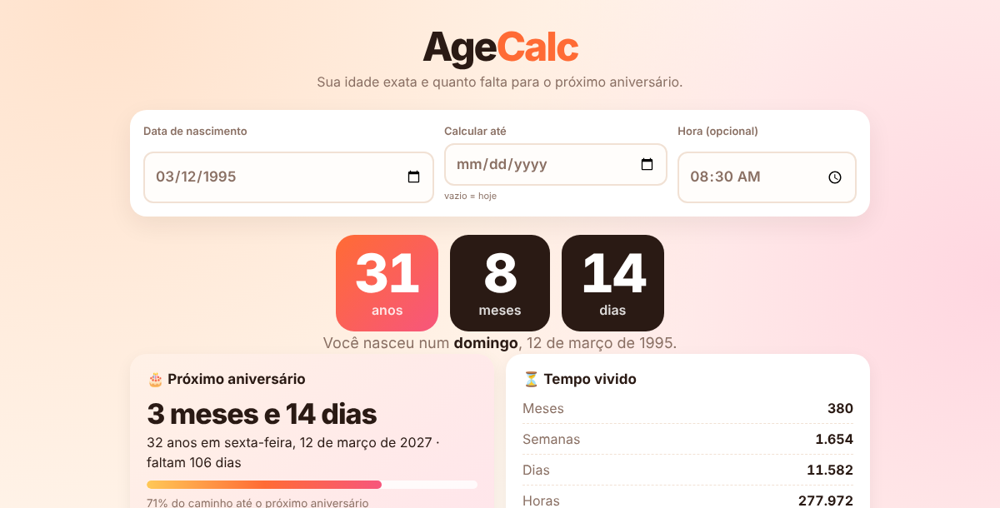

# AgeCalc — Calculadora de idade

Descubra a idade exata em anos, meses e dias, quanto falta para o próximo aniversário e curiosidades sobre o tempo vivido.

🔗 **[Ver o site no ar](https://iamviniciuslima05.github.io/PROJETO-AgeCalc/)**



## Funcionalidades

- Idade exata em **anos, meses e dias**
- **Contagem regressiva** para o próximo aniversário com barra de progresso
- Tempo vivido em **meses, semanas, dias, horas e minutos**
- **Signo**, horóscopo chinês, geração e estação do ano em que nasceu
- Idade em **outros planetas**
- **Marcos** como 10.000 dias de vida e 1 bilhão de segundos
- Trata quem nasceu em **29 de fevereiro**
- Calcula até qualquer data e **copia um resumo**

## Tecnologias

HTML5 · CSS3 · JavaScript · localStorage

## Estrutura

```
index.html
css/style.css
js/script.js
```

## Como rodar

Não precisa instalar nada: baixe o projeto e abra o `index.html` no navegador, ou acesse a versão publicada acima.

---
Feito por **Vinicius Lima** · [Portfólio](https://viniciuslimadev.netlify.app) · [LinkedIn](https://www.linkedin.com/in/viniciuslima25/)
